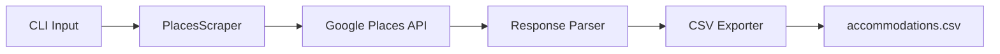

# Scraper de Alojamientos con Google Places API

## Arquitectura General




## Stack Tecnologico

- **Python 3.11+**
- **httpx**: Cliente HTTP async para llamadas a la API
- **typer**: Framework CLI moderno
- **pandas**: Procesamiento y exportacion a CSV
- **python-dotenv**: Manejo de API keys
- **rich**: Output formateado en terminal

## Estructura del Proyecto

```
/Users/abettucci/Downloads/accommodation-scraper/
├── pyproject.toml          # Dependencias (Poetry)
├── .env.example            # Template para API key
├── README.md               # Documentacion
└── src/
    └── scraper/
        ├── __init__.py
        ├── cli.py          # Comandos CLI (typer)
        ├── client.py       # Google Places API client
        ├── models.py       # Dataclasses para Places
        └── exporter.py     # Export a CSV
```

## Google Places API - Campos a Extraer

Usando **Text Search (New)** endpoint (`POST https://places.googleapis.com/v1/places:searchText`):


| Campo            | API Field                  | SKU        |
| ---------------- | -------------------------- | ---------- |
| Nombre           | `displayName`              | Pro        |
| Direccion        | `formattedAddress`         | Pro        |
| Coordenadas      | `location`                 | Pro        |
| Rating           | `rating`                   | Enterprise |
| Reviews count    | `userRatingCount`          | Enterprise |
| Nivel de precio  | `priceLevel`               | Enterprise |
| Telefono         | `internationalPhoneNumber` | Enterprise |
| Website          | `websiteUri`               | Enterprise |
| Google Maps link | `googleMapsUri`            | Pro        |
| Tipo             | `primaryType`              | Pro        |
| Reviews (texto)  | `reviews`                  | Enterprise |


**Nota**: Los campos Enterprise tienen costo adicional. El plan incluye opcion para usar solo campos Pro (mas economico).

## Flujo de Busqueda

1. Usuario ejecuta: `python -m scraper search "hostels in Buenos Aires"`
2. CLI parsea argumentos y configura filtros
3. Client hace POST a Text Search API con query y field mask
4. Parser extrae datos relevantes de cada place
5. Si hay `nextPageToken`, continua paginando (max 60 resultados por busqueda)
6. Exporter genera CSV con timestamp

## Comandos CLI

```bash
# Busqueda basica
scraper search "hotels in Mendoza" --output hotels_mendoza.csv

# Con filtros
scraper search "hostels in Bariloche" --min-rating 4.0 --max-results 50

# Solo campos economicos (Pro SKU)
scraper search "airbnb in Cordoba" --budget-mode

# Ver campos disponibles
scraper fields
```

## Consideraciones de Costos

- **Text Search Pro**: ~$32 por 1000 requests (campos basicos)
- **Text Search Enterprise**: ~$40 por 1000 requests (incluye reviews, rating, precio)
- Credito mensual de $200 USD disponible en Google Cloud

## Output CSV Esperado

```csv
name,address,lat,lng,rating,reviews_count,price_level,phone,website,google_maps_url,type,top_review
Hotel Palermo,Av. Santa Fe 1234,-34.58,-58.42,4.5,230,MODERATE,+54 11 1234,https://...,https://maps.google.com/...,hotel,"Excelente ubicacion..."
```

